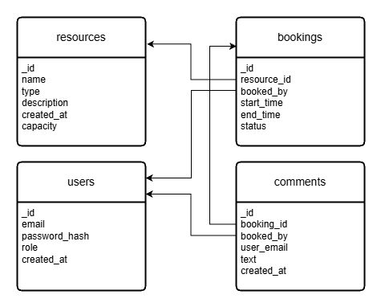
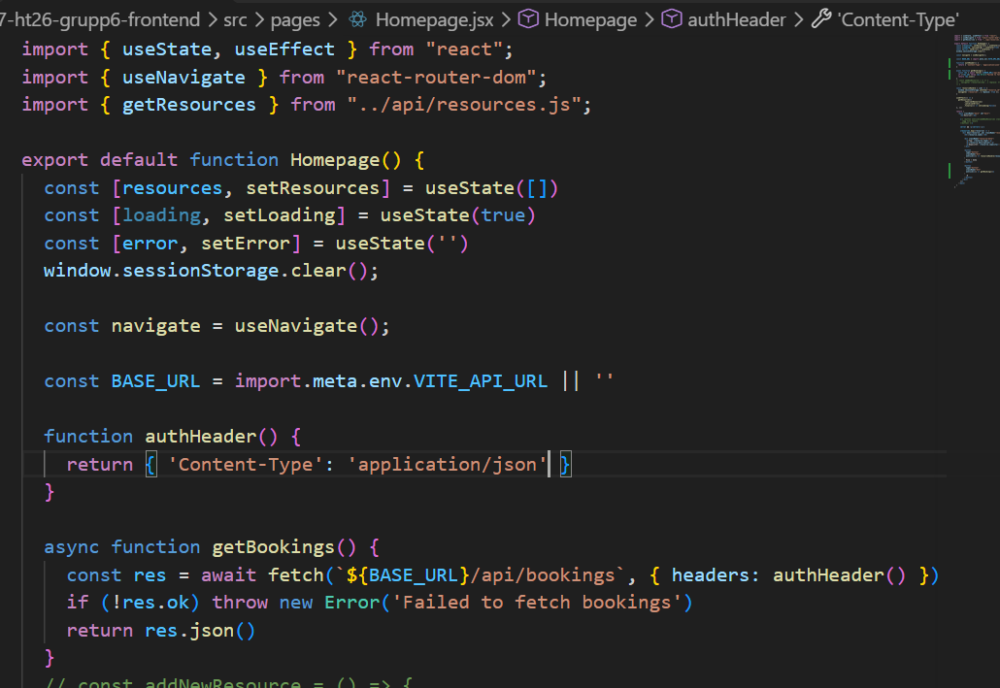

# Proxmox Booking HT26

Ett bokningssystem för resurser
(t.ex. virtuella maskiner i Proxmox), byggt med Express och MongoDB

# dv1677-ht26-grupp6-backend

## Gruppmedlemmar

| Namn | GitHub |
|------|--------|
| Johanna Johansson | @jojjan-johansson |
| Rebecka Corell | @beckabeckis |

## Projektval

Vi har valt  **bokningssystem**

Motivering:

Vi valde projektet bokningssystem för det verkade som ett intressant projekt och något som kan komma
till nytta att kunna i framtida yrken.

## Teknikval

**Frontend-ramverk:** React

Motivering:

Vi valde React dels för att vi båda har jobbat i det innan men också för att det är 
väldigt vanligt. Vi tror att det är det ramverket vi kommer att ha mest nytta av i framtiden.

## Kör lokalt

```bash
git clone git@github.com:beckabeckis/dv1677-ht26-grupp6-backend.git
cd dv1677-ht26-grupp6-backend
cp .env.example .env
npm install
npm start
```

Öppna sedan `http://localhost:3000`


## Tester

För att köra tester kör kommandot:

> ```npm test```

Testar tre olika typer av routes:
- GET: hämta alla resurser
- POST: lägga till en ny resusrs
- DELETE: ta bort en resurs

Detta testas för att se att databasen är kopplad korrekt, det går att hämta, ändra och ta bort data korrekt och routsen fungerar som planerat.

## Driftsatt

- Frontend: [https://jojjan-johansson.github.io/dv1677-ht26-grupp6-frontend/](https://jojjan-johansson.github.io/dv1677-ht26-grupp6-frontend/)
- Backend: [https://dv1677-geordi.nplab.bth.se/](https://dv1677-geordi.nplab.bth.se/)


## Tillvägagångssätt

Dokumentera löpande vad ni gjort och hur ni löst problem.

- Vecka 1-2: 

Diskuterat och bestämt vilket projekt och vilket ramverk vi kommer jobba med i kursen.
Vi har haft tre möten där vi har diskuterat uppgiften, t.ex. hur vi skulle göra PUT-route då det inte var så tydligt i 
instruktionerna hur man skulle lösa den delen. Vi mailade läraren om hjälp och löste sedan uppgiften.

- Vecka 3:

Vi jobbade med databasen, migrerade från SQLite till MongoDB.
Skapade seed.js fil som byggde upp databasen med data.
Tog bort alla vyer och skrev om app.js till att endast hantera ett JSON api.

- Vecka 4:

Kopplade oss till VPS med SSH-nycklar.
Skrev git workflow filerna ci.yml och deploy.yml och driftsatte projektet i github.

- Vecka 5:

Utökade dokumenten i MongoDB och la till fler routes.
Installerade Vite och Supertest och skrev om app.js och la till server.js så att testerna skulle fungera.
Skrev tester till tre routes; GET, POST och DELETE resources.-


## Env-variabler

`PORT` - porten som Express lyssnar på -> `3000`

`MONGODB_URI` - uri för att koppla dig till databasen -> `mongodb://localhost:27017`

`DATABASE_NAME` - namn på databas -> `resourcebooking`

## Teknikstack

- [Node](https://nodejs.org)
- [Express](https://expressjs.com)
- [MongeDB](https://www.mongodb.com/)
- [React](https://react.dev/)
- [Vite](https://vite.dev/)

## MongoDB 

Projektet använder databasen MongoDB som en docker-container i en VPS-server.

GitHub secrets:

- VPS_HOST — IP-adressen till vår VPS.
- VPS_USER — Linux-användaren på VPS (ubuntu).
- VPS_SSH_KEY — privat del av vår deploy-nyckel.
- MONGODB_URI — anslutningssträng till databasen. Docker-container på VPS: mongodb://mongodb:27017.

## Datamodell




## Krav 1 - JWT-autentisering

### I backend:

Vi har lagt till JWT_SECRET som en github secret med en randomiserad sträng, samt lagt in i .env för lokal testkörning. 

Vi har lagt till routes för att logga in och registrera sig där de tar emot email och lösenord. Register routen lägger in email och en, med hjälp av bcrypt, haschad version  av lösenordet i en ny användare i databasen och skickar tillbaka en signerad jwt token och ett user objekt. Login routen kollar om en user med den emailen finns och om det är ok så jämförs lösenorden med hjälp av bcrypt. Om allt stämmer så skickas det tillbaka en signerad jwt token och ett user objekt.

Vi har gjort en middleware som vi använder i booking routsen för att verifiera att den som anropar routsen är inloggad, samt inloggad som admin. Middlewaren har två funktioner, en som kollar att användaren är autentiserad, requireAuth, och en som kollar om användaren är admin, requireAdmin. requireAuth kollar först att headern på API-anropet är korrekt genom att kolla om den börjar med 'Bearer ' som den borde om den har en token med sig. Om det stämmer så tar den ut token från headern och med hjälp av jwt så verifieras token mot JWT_SECRET. Med hjälp av svaret från verifieringen så hämtas den aktuella användaren och kollar att användaren finns i databas. Om allt är okej så höjs inga varningar och routen som funktioner används i kan fungera som vanligt. requireAdmin kollar om användaren har rollen admin, om inte så höjs en varning annars så kan routen som funktioner används i kan fungera som vanligt.

Vi valde att alla användare kan se översikten över resurserna men behöver logga in för att se och hantera bokningar. Vi bestämde även att endast admin kan avboka bokningar, övriga användare kan endast förlänga bokningne med en timme, och admin kan även se och hantare allas boknigar medans övriga användare endast kan hatera sina egna.


**Routes som kröver autentisering:**

- GET /bookings
- GET /bookings/resource/:id
- GET /bookings/:id
- POST /bookings
- POST /bookings/:id
- DELETE /booking/cancel/:id

**Filer som har lagts till / ändrats:**

- controllers/authController.js
- middleware/auth.js
- routes/auth.js
- routes/bookings.js
- .env
- .env.example

### I frontend:

Vi har lagt till en login sida och en registrera sida där användaren kan logga in eller registrera sig som en ny användare. 

Vi har lagt till en AuthContext.jsx med två funktioner, en för att logga in och en för att logga ut genom att lägga till username och token i localstorage respektive rensa dessa. Funktionerna, user och token läggs till i en kontext som används i pages för att enkelt kunna logga in och ut.
Vi har skapat ett auth api med en login funktion som skickar user och lösenord till backends login route med fetch och en funktion som gör motsvarande för att registrera ny användare.

Vi har uppdaterat booking api så att det skickas med en token i headern så att endast inloggade användare kan se, lägga till, ändra och avboka bokningar. Endast admin kan ta bort bokningar.

Vi har uppdaterat resource page för att använda korrekta api:er, lägga till avboka, ta bort och ändra bokning funktioner och se till att endast inloggade användare kan komma in på detaljvyn över varje resurs och dess bokningar och att endast admin kan se allas bokningar (övriga användare ser endast sina egna). 


**Filer som har lagts till / ändrats:**

- src/api/auth.js
- src/api/bookings.js
- src/context/AuthContext.jsx
- src/pages/Login.jsx
- src/pages/Register.jsx
- src/pages/Resource.jsx
- src/App.jsx

### Anrop utan token

Här har vi temporärt lagt in en funktion i frontend som hämtar alla bokningar men utan token som behövs för att autentiseras i backend (funktionen anropas i en temporär knapp):

Funktionen:


Resultat i devtools (ger error 401):


## Krav 4 - Bokningssystem: bokningslogik

### I Backend

Vi har skapat en fil, overlap.js, med två funktioner. En som heter intervalsOverlap och kollar att två bokningar inte är överlappar varandra, overlap villkoret ser ut såhär:

> ```a.start_time < b.end_time && b.start_time < a.end_time```

Den andra heter findConflicts och kollar i databasen att det inte redan finns en bokning på den nya bokningens tider.

Vi har även skapat en fil, policy.js, som har en funktion som heter controlBookingPolicy. Den tar en bokning och kollar tre saker; 1: att bokningen inte är mer än fyra timmar, 2: att bokningen inte startar i dåtiden, 3: att användaren inte har mer än 3 bokningar. Detta så att det inte blir för mycket eller för långa onödiga bokningar.

I getBooking och editBooking routesen så används findConflicts och controlBookingPolicy funktionerna innan bokningen bokas av brokern och läggs in i databasen för att se att bokningen inte bryter mot några av dessa policys eller skapar en konflikt. Om bokningen skulle bryta mot en policy eller skapa en konflikt så avbryts routen med statuskoden 409 eftersom API anropet fungerade bra men att bokningen inte gick igenom på grund av konflikter med existerande bokningar eller policyn. Statuskoden 409 passar därför bra enligt [MDN Web Docs](https://developer.mozilla.org/en-US/docs/Web/HTTP/Reference/Status/409):

>"The HTTP 409 Conflict client error response status code indicates a request conflict with the current state of the target resource."

Vi har skapat en till fil, availability.js, som kollar alla en angiven dags lediga tider från databasen på en angiven resurs och skickar tillbaka lediga tid-slotter i en timmes intervaller. Funktionen tar starttiden 8:00 och sluttiden 18:00 (öppettiderna) och hämtar alla bekräftade bokningar för den dagen. Sedan skapar den alla tid-slotter som får plats mellan öppettiderna och slutligen jämförs slotsen med bokningarna med hjälp av intervalsOverlap funktionen från overlap.js. De slotsen får available: true om de är lediga och available: false annars.
Denna funktion används i en route som tar emot resource id och date och skickar tillbaka de lediga slotsen, getAvailability.

**Filer som har lagts till / ändrats:**

- domian/availability.js
- domian/overlap.js
- domian/policy.js
- routes/booking.js
- routes/resources.js


## I Frontend

Vi har lagt in en ny API funktion som anropar getAvailability från backend. I Resource.jsx så hämtas dagens datum som tillsammans med den aktuella resursens id skickas med i ett anrop till getAvailability funktionen. Svaret med slots sparas i en variabel som använss i formuläret för att boka en ny tid. För varje slot så kollas först att början på slot-tiden inte har passerat i nuvarande tid och sedan skapad en div i ett rutnät med start och slut tid. Datan available kollas på sloten och om den är true så blir diven klickbar och om användaren väljer denna tid så sparas start och slut tiden från sloten som skickas med som bokningens start och slut tid. Om användaren väljer ett annat datum så laddas slotsen om med det nya datumet.

**Filer som har lagts till / ändrats:**

- src/api/resources.js
- src/pages/Resources.jsx
